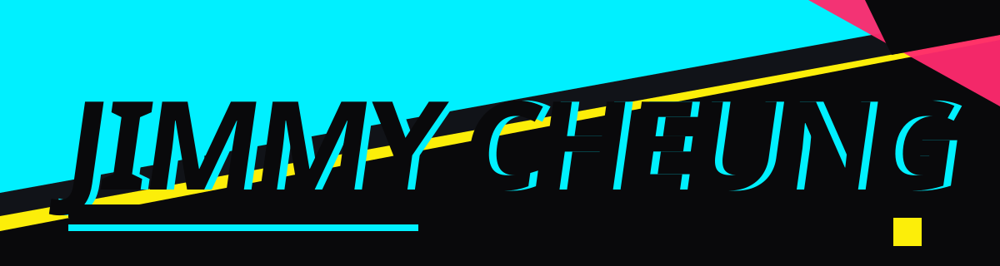

<h3>Developer · Entrepreneur · Builder</h3>

  <a href="https://imjimmy.me">Personal website</a>
  ·
  <a href="https://x.com/twzkd">X / Twitter</a>
  ·
  <a href="https://instagram.com/catchjch">Instagram</a>

## Hi, I'm Jimmy

I’m a 16-year-old developer and entrepreneur building products while studying at Ruian High School. I like turning overwhelming ideas into clear, useful experiences—and I’m always learning by shipping.

> **Currently building:** SSC 2027 — pushing my technical limits to ship something real.

## Selected work

| Project | What it is |
| --- | --- |
| **Bloom App** | A Swift Student Challenge project focused on thoughtful, polished interactions. |
| **Soark App** | A project-planning app that turns overwhelming chaos into clear, actionable steps. |

## What I care about

- **Product:** simple interfaces, intentional details, and experiences that feel effortless.
- **Technology:** modern software, Apple platforms, and the ideas shaping what comes next.
- **Growth:** learning in public, building consistently, and finishing what I start.

## Outside the editor

I watch and play soccer (especially Real Madrid), enjoy story-rich games like *The Legend of Zelda*, *Cyberpunk 2077*, and *The Witcher*, and follow the latest software and hardware trends.

## Let’s connect

If you’re building something interesting, I’d love to hear from you.

&nbsp;

 
 

 
 

